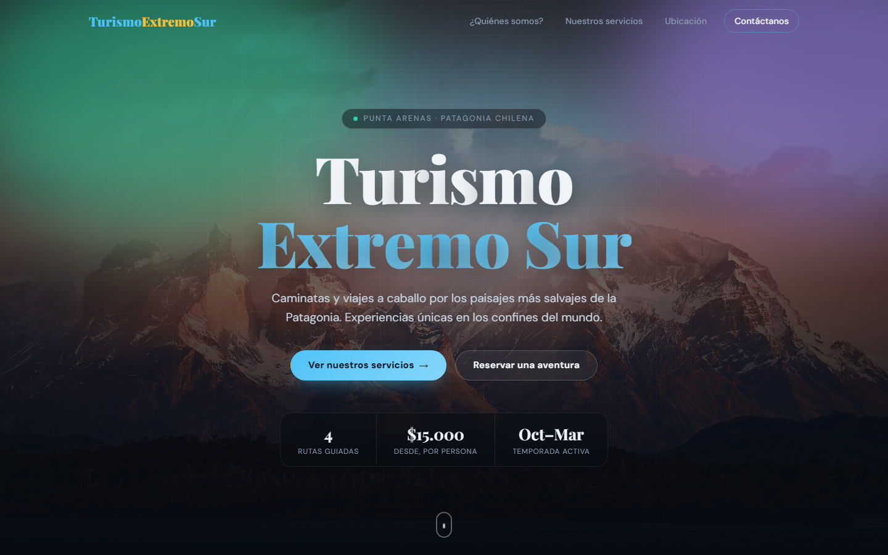

<div align="center">

# 🏔️ Turismo Extremo Sur

### Caminatas y viajes a caballo por la Patagonia chilena, desde Punta Arenas

<a href="https://turismo-extremo-sur-zeta.vercel.app">
  
</a>

<br /><br />


[](https://github.com/Fernandamv96/turismo-extremo-sur/actions/workflows/ci.yml)
[](LICENSE)

<br />



</div>

<br />

## 🎯 ¿Qué problema resuelve?

Le da a una agencia de turismo aventura de Punta Arenas una vitrina web rápida y sin dependencias para mostrar sus rutas, precios y ubicación, y para recibir consultas de reserva.

## ✨ Características

- 🌌 **Hero** con foto de los Cuernos del Paine, aurora austral animada y título que aparece letra por letra
- 🧭 **¿Quiénes somos?** con tarjetas del equipo generadas desde un arreglo (`mostrarEquipo()`)
- 🥾 **Nuestros servicios** renderizados dinámicamente en el DOM (`mostrarServicios()`), con foco de luz que sigue al cursor
- 🗺️ **Mapa** de Punta Arenas con Google Maps
- 📬 **Formulario de contacto** con validación en JavaScript (`validarFormulario()`, `limpiarFormulario()`)
- 📱 **Responsive**, con menú hamburguesa en celular, y respeta la preferencia de reducir movimiento

## 🥾 Servicios

| Servicio | Tipo | Duración | Precio por persona |
|:---|:---|:---:|---:|
| Monte Tarn | Caminata | 8 hrs | $25.000 |
| Laguna Parrillar | Caminata | 6 hrs | $18.000 |
| Mirador Zapador Austral | Caminata | 4 hrs | $15.000 |
| Cabalgata Patagónica | Cabalgata | 1 día | $35.000 |

Para agregar o modificar servicios, edita el arreglo `servicios` en [`js/main.js`](js/main.js).

## 📁 Estructura

```
turismo-extremo-sur/
├── index.html      ← estructura de la página
├── css/styles.css  ← estilos (CSS puro, sin frameworks)
├── js/main.js      ← datos, renderizado en el DOM, validaciones y animaciones
├── img/            ← fotografías de los lugares
├── vercel.json     ← despliegue + headers de seguridad (CSP, X-Frame-Options…)
└── package.json    ← solo herramientas de lint (el sitio no tiene build)
```

## 🚀 Ejecutar en local

No necesita instalación. Clona el repositorio y abre `index.html`, o sírvelo con un servidor local:

```bash
git clone https://github.com/Fernandamv96/turismo-extremo-sur.git
cd turismo-extremo-sur
python -m http.server 8000   # http://localhost:8000
```

Para revisar el código:

```bash
npm ci
npm run lint      # ESLint (js/) + html-validate (index.html)
```

## 📸 Créditos de las fotografías

Imágenes de [Wikimedia Commons](https://commons.wikimedia.org):

- Cuernos del Paine — Pedro Szekely, CC BY-SA 2.0
- Monte Tarn — U.S. Marine Corps, Sgt. Gabriel Groseclose-Durand, dominio público
- Laguna Parrillar — Alvaro.galvez, CC BY-SA 4.0
- Mirador Zapador Austral — Andy Calavera, CC BY-SA 4.0
- Caballos ante los Cuernos del Paine — Diego Delso, CC BY-SA 3.0
- Estrecho de Magallanes — Entropy1963, dominio público

## 🔒 Seguridad y accesibilidad

- Headers en `vercel.json`: CSP sin scripts ni estilos inline, `X-Frame-Options`, `X-Content-Type-Options`, `Referrer-Policy` y `Permissions-Policy`.
- Verificado con axe-core (WCAG 2.1 AA) y sin scroll horizontal a 375 px. Respeta `prefers-reduced-motion`.
- CI con lint, CodeQL, Dependabot y gitleaks (pre-commit). Para reportar vulnerabilidades, mira [SECURITY.md](SECURITY.md).

## 💡 Qué aprendí

- A renderizar contenido desde arreglos de datos en JavaScript puro (`mostrarServicios()`).
- A validar formularios en el cliente con mensajes accesibles.
- Que una CSP estricta prohíbe `style="..."` inyectado por `innerHTML`, y a usar CSSOM (`el.style`) en su lugar.
- A medir el contraste real cuando hay fondos animados detrás de un navbar translúcido.

## 📄 Licencia

Código bajo [MIT](LICENSE) © 2026 Fernanda (Fernandamv96). Las fotografías mantienen sus licencias originales (ver créditos).
